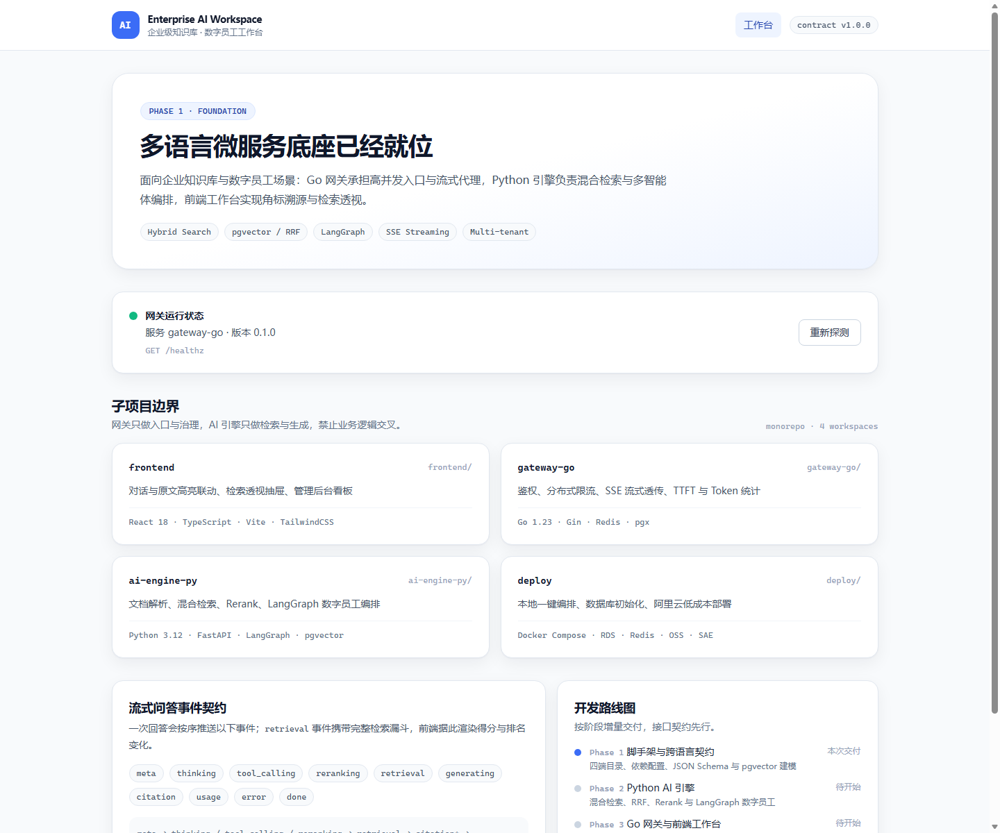

# 本地开发环境（Windows 11）

本文记录当前工作机的实际安装方式，确保从空会话可以完整启动
PostgreSQL(pgvector) + Redis + AI 引擎 + Go 网关 + React 前端。

> 相关文档：[架构与契约](ARCHITECTURE.md) · [部署说明](../deploy/README.md) ·
> [一键脚本](../scripts/dev/README.md)

## 1. 已安装组件

| 组件 | 版本 | 位置 | 说明 |
| --- | --- | --- | --- |
| Docker Desktop | 4.100.1 | `D:\Docker\DockerDesktop` | **per-user 安装**，无需管理员/UAC |
| Docker Engine | 29.9.3 | WSL 2 | `docker-desktop` 发行版 |
| Docker Compose | v5.7.1 | Docker Desktop 插件 | `docker compose` |
| Docker 数据盘 | — | `D:\Docker\data` | WSL VHDX，主数据不在 C 盘 |
| Git | 2.56.1 | `D:\tools\git` | MinGit 便携版 |
| Go | 1.23.4 | `D:\tools\go` | 与 `gateway-go/go.mod` 一致 |
| Node.js / npm | 24.19.0 / 11.17.0 | `D:\Program Files\nodejs` | 前端构建 |
| Python | 3.14.2 | `C:\Users\<user>\AppData\Local\Programs\Python\Python314` | 既有安装；项目虚拟环境在仓库内 |
| PostgreSQL | 16.16 | `pgvector/pgvector:pg16` 容器 | 端口 `5432` |
| pgvector | 0.8.7 | 同上 | `vector` 扩展 |
| Redis | 7.4 | `redis:7.4-alpine` 容器 | 端口 `6379` |

用户级 `PATH` 已加入：

```
D:\Docker\DockerDesktop\resources\bin
D:\tools\go\bin
D:\tools\git\cmd
C:\Windows\System32\OpenSSH
```

新开终端后 `docker`、`go`、`git` 应直接可用。当前进程若未刷新，可用绝对路径或重新登录。

依赖缓存也统一放在 D 盘：

| 缓存 | 位置 |
| --- | --- |
| Go module / build cache | `D:\tools\go\modcache`、`D:\tools\go\buildcache` |
| npm cache | `D:\tools\npm-cache` |
| pip cache | `D:\tools\pip-cache` |
| Docker Desktop 安装包缓存 | `D:\tools\docker-desktop\DockerDesktopInstaller.exe` |

> Phase 1 的 Compose 只编排 PostgreSQL/Redis；Go/Python/前端在 Windows 上以
> 原生进程运行，便于即时改代码。Phase 4 再将应用服务容器化进 Compose。

## 2. 一键启停

在仓库根目录执行（Windows PowerShell 5.1 已验证）：

```powershell
# 启动 Docker 基础设施 + 引擎 + 网关 + 前端
powershell.exe -ExecutionPolicy Bypass -File scripts\dev\start-all.ps1

# 查看状态（含容器）
powershell.exe -ExecutionPolicy Bypass -File scripts\dev\status.ps1

# 停止应用进程，保留容器
powershell.exe -ExecutionPolicy Bypass -File scripts\dev\stop-all.ps1

# 停止应用进程并停止容器
powershell.exe -ExecutionPolicy Bypass -File scripts\dev\stop-all.ps1 -WithInfra
```

脚本行为：

- 若 Docker 引擎未运行，会自动启动 Docker Desktop 并最多等待 180 秒；
- 自动执行 `docker compose up -d --wait`；
- 构建 `gateway-go` 到 `.local/bin/gateway.exe`，启动引擎/网关/前端；
- PID 与日志在 `.local/`（已 gitignore）；
- 前端默认 `http://127.0.0.1:5173`，网关 `:8080`，引擎 `:8000`。



## 3. 手工启动

```powershell
# 0) 启动 Docker Desktop（若未启动），确认引擎
docker info

# 1) 基础设施
cd deploy
docker compose up -d --wait
docker compose ps

# 2) AI 引擎（新终端）
cd ai-engine-py
.\.venv\Scripts\python.exe -m uvicorn app.main:app --host 127.0.0.1 --port 8000

# 3) Go 网关（新终端）
cd gateway-go
go run ./cmd/gateway

# 4) 前端（新终端）
cd frontend
npm run dev -- --host 127.0.0.1
```

首次启动容器时，入口脚本会自动执行
[`deploy/initdb/01_schema.sql`](../deploy/initdb/01_schema.sql)；
该脚本已在 PG 16.16 + pgvector 0.8.7 上实际跑通。

## 4. 验证清单

```powershell
# 容器与端口
docker compose -f deploy/docker-compose.yml ps
Test-NetConnection 127.0.0.1 -Port 5432
Test-NetConnection 127.0.0.1 -Port 6379

# 扩展与表
docker compose -f deploy/docker-compose.yml exec -T postgres `
  psql -U workspace -d workspace -c "SELECT extname, extversion FROM pg_extension ORDER BY 1;"
docker compose -f deploy/docker-compose.yml exec -T postgres `
  psql -U workspace -d workspace -c "\dt"

# 健康检查
curl.exe http://127.0.0.1:8080/healthz
curl.exe http://127.0.0.1:8080/readyz
curl.exe -H "X-Internal-Token: dev-internal-token-change-me" `
  http://127.0.0.1:8000/internal/v1/health

# 数据库冒烟测试（事务内 ROLLBACK，不污染数据）
powershell.exe -ExecutionPolicy Bypass -File scripts\db\verify.ps1
```

期望：

- `/readyz` 返回 `200`，`postgres`、`redis`、`ai_engine` 均为 `ok`；
- 引擎在未配置 `LLM_API_KEY` 时为 `degraded`（HTTP 200），这是 Phase 1 的正常状态；
- 前端页面状态卡片显示网关在线。

本机实测通过的关键项：

| 检查 | 结果 |
| --- | --- |
| PostgreSQL 扩展 | `vector 0.8.7`、`pg_trgm 1.6` |
| 建表脚本 | 无错误，19 张表/分区 |
| 向量索引 | HNSW `idx_chunks_embedding_hnsw` 实际命中 |
| 全文索引 | GIN `content_tsv`、`pg_trgm` 已创建 |
| BM25 | `app.bm25_score(...)` 返回有效分数 |
| RLS | 14 条租户策略 |
| Compose 健康检查 | `eaw-postgres` / `eaw-redis` healthy |

## 5. 配置

- `deploy/.env`：PostgreSQL/Redis 本地凭据（由 `.env.example` 复制）；
- `gateway-go/.env`：数据库、Redis、内部 Token、端口；
- `ai-engine-py/.env`：数据库、内部 Token、LLM/Embedding/OSS 配置；
- `frontend/.env.local`：API 基址与 Vite 代理目标。

本地默认 Token 为 `dev-internal-token-change-me`，仅限本机。

### 大模型 Key

当前未配置 `LLM_API_KEY`，因此引擎健康状态为 `degraded`，Phase 1 的健康探针与
网关联调不受影响。Phase 2 开始检索/生成前，需要按能力分别配置三组凭证：

```dotenv
# 对话/Agent（DeepSeek 示例）
LLM_BASE_URL=https://api.deepseek.com
LLM_API_KEY=sk-<deepseek-key>
CHAT_MODEL=deepseek-flash

# Embedding（DeepSeek 官方不提供，需百炼或本地 BGE-M3）
EMBEDDING_BASE_URL=https://dashscope.aliyuncs.com/compatible-mode/v1
EMBEDDING_API_KEY=sk-<dashscope-key>
EMBEDDING_MODEL=text-embedding-v3

# Rerank（百炼 gte-rerank 或本地 bge-reranker）
RERANK_BASE_URL=<endpoint>
RERANK_API_KEY=sk-<dashscope-key>
RERANK_MODEL=gte-rerank-v2
```

完整能力矩阵与 DeepSeek 接入注意事项见
[模型供应商选型](LLM_PROVIDERS.md)。修改 `ai-engine-py/.env` 后重启引擎。

## 6. 数据重置

仅在需要重新执行 DDL 时使用（会丢失本地数据）：

```powershell
docker compose -f deploy/docker-compose.yml down -v
docker compose -f deploy/docker-compose.yml up -d --wait
```

`down -v` 会删除 `eaw-postgres-data`、`eaw-redis-data` 两个卷。若只是修改了
SQL，建议先备份或新建迁移脚本，不要直接重置。

## 7. 故障排查

| 现象 | 处理 |
| --- | --- |
| `docker` 命令找不到 | 重新打开终端；或使用 `D:\Docker\DockerDesktop\resources\bin\docker.exe` |
| Docker 引擎未运行 | 启动 Docker Desktop，等待托盘图标变为 running；或运行 start-all |
| 端口 5432/6379 被占用 | `Get-NetTCPConnection -LocalPort 5432` 定位进程，停止冲突服务 |
| 容器 `Restarting` | `docker compose logs postgres`；初始化 SQL 错误会出现在这里 |
| `readyz` 503 | 先看引擎 `/internal/v1/health` 与 `docker compose ps` |
| 前端 5173 被占用 | 运行 `stop-all.ps1`，或修改 Vite 端口/代理 |
| PowerShell 脚本被拦截 | 使用 `powershell.exe -ExecutionPolicy Bypass -File ...` |

Docker Desktop 的 CLI 插件缓存位于 `%USERPROFILE%\.docker`（体积很小）；
镜像、容器、卷的实际数据已通过安装参数
`--wsl-default-data-root=D:\Docker\data` 放到 D 盘。
